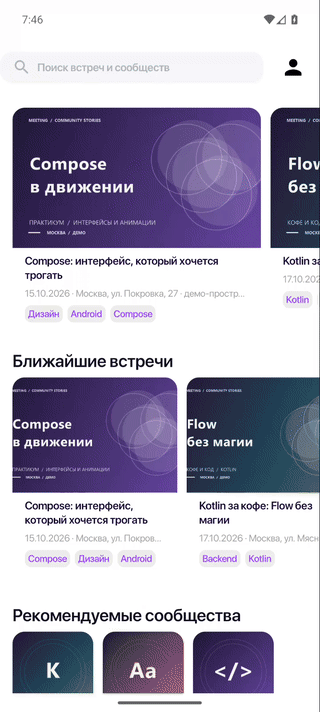

# Meet

Android-приложение для поиска встреч, знакомства с участниками и сообществами.
Pet-проект с собственным Kotlin-бэкендом, многомодульной архитектурой и Compose UI.

## Демонстрация

<p align="center">
  
</p>

**Лента → детали встречи → место проведения.** В GIF — локальная демонстрация
с вымышленными встречами, площадками и профилями. Обложки и аватары созданы
для проекта; карта — иллюстрация района, а не географическая карта.
Демонстрация не является проверкой production-окружения.

## Возможности

- Лента ближайших встреч, поиск и фильтры по интересам.
- Подробности события, ведущий, участники и запись на встречу.
- Сообщества, подписки и профиль пользователя.
- Push-уведомления и напоминания о встречах.

## Стек

**Kotlin · Jetpack Compose · Material 3 · Koin · Ktor · Coroutines / Flow ·
Paging · Coil · WorkManager · Firebase**

Версии зависимостей — в [каталоге Gradle](gradle/libs.versions.toml).
Настройки Android и Kotlin централизованы в convention plugins в `build-logic`.

## Архитектура

Feature-модули разделены на `data / domain / presentation`:

```text
Ktor API → DTO и мапперы → репозитории → use cases → ViewModel → Compose
```

| Модули | Ответственность |
| --- | --- |
| `app` | Сборка зависимостей, навигация, push и напоминания |
| `features/auth` | Авторизация |
| `features/meetings` | Встречи, поиск и участники |
| `features/communities` | Сообщества и подписки |
| `features/profile` | Профиль и настройки |
| `core` | Сеть, авторизация, общие модели, утилиты и тестовые fixtures |
| `uikit` | Переиспользуемые компоненты, тема, токены и графика |

Полный список Gradle-модулей — в [settings.gradle.kts](settings.gradle.kts).
Presentation-слой использует domain-контракты и не зависит от `core:network`.

## Быстрый старт

Требуются **JDK 21**, **Android SDK 36** и устройство/эмулятор с **Android 11+**
(API 30). Настройте `sdk.dir` в локальном, игнорируемом Git файле `local.properties`.
Бэкенд запускается отдельно.

Для локального debug и CI в репозитории есть **несекретный** Firebase fixture:

```sh
cp app/google-services-ci.json app/google-services.json
./gradlew :app:assembleDebug
```

Windows PowerShell:

```powershell
Copy-Item app/google-services-ci.json app/google-services.json
.\gradlew.bat :app:assembleDebug
```

Откройте проект в Android Studio и запустите вариант `debug`.
По умолчанию API доступен через `http://10.0.2.2:8080` — адрес компьютера
из Android Emulator. Для другого сервера передайте свой origin:

```sh
./gradlew :app:assembleDebug -PBASE_URL_DEBUG=http://10.0.2.2:8089
```

`app/google-services.json` не коммитится. Fixture предназначен только для локального
debug и CI: он не заменяет защищённую Firebase-конфигурацию snapshot/release.

## Проверки

После подготовки Firebase fixture:

```sh
./gradlew ktlintCheck
./gradlew :app:lint
./gradlew testDebugUnitTest
python -m unittest discover -s scripts/release -p "test_*.py"
./gradlew :app:assembleDebug
```

На Windows используйте `.\gradlew.bat` вместо `./gradlew`.
CI выполняет статический анализ, тесты и debug-сборку; release-инструменты
и их тесты в `scripts/release` — часть действующей инфраструктуры.

## Релизы

- `dev` — интеграционная ветка и snapshot-кандидаты.
- `master` — стабильные релизы.
- Release использует только `https://api.whysoezzy.online`; успешная snapshot-сборка
  сама по себе не означает публикацию production-релиза.
- Firebase-конфигурация, keystore, пароли и signing inputs для snapshot/release
  поступают через защищённый release-процесс и не хранятся в Git.

Процедуры сборки, подписи, проверки и публикации —
в [руководстве по релизам](docs/android-release-operations.md).
История стабильных версий — в [CHANGELOG](CHANGELOG.md).
